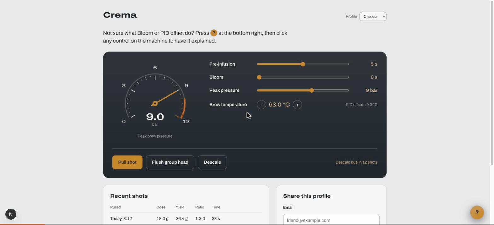
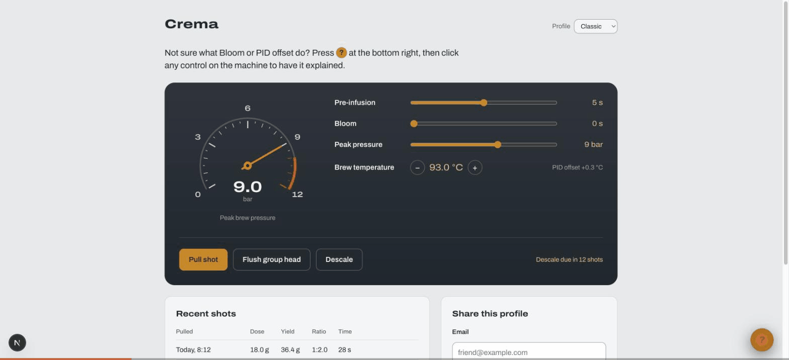
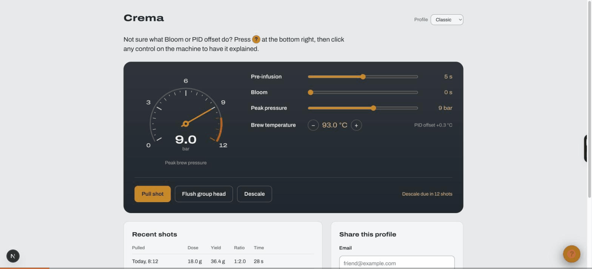
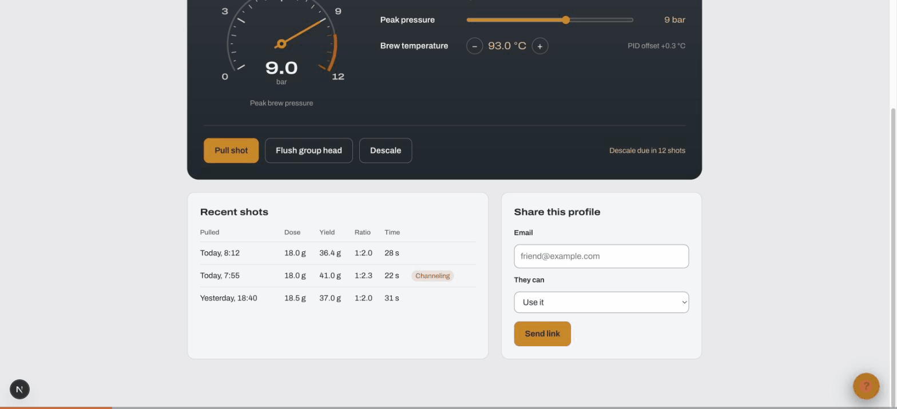
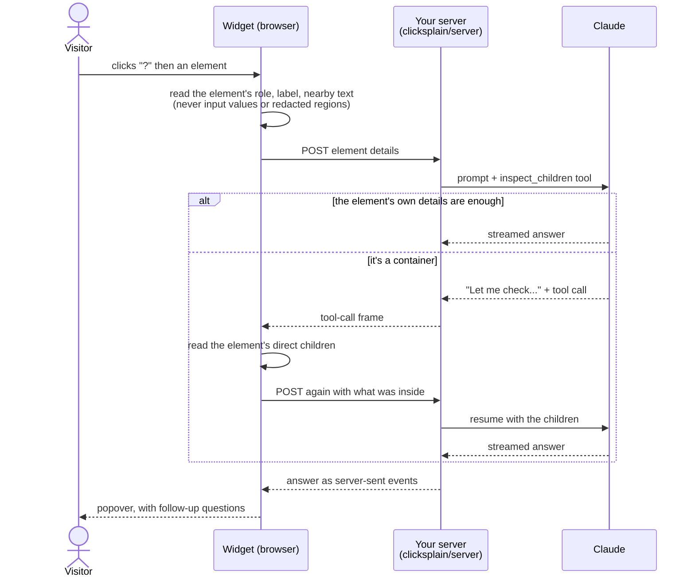

# clicksplain

[](https://www.npmjs.com/package/clicksplain)
[](./LICENSE)

A drop-in, AI-powered "explain this UI" widget. Click the "?" button, then click any element on the page to get an LLM-generated explanation of what it does, rendered in a popover anchored to the element, with follow-up questions.



No hosted backend: you choose how the widget reaches a model.

| Connector | Where the model call happens | Use it for |
|---|---|---|
| `byo-endpoint` | Your own server, using `clicksplain/server` | Production (recommended): the key never reaches the browser |
| `puter` | The visitor's browser, through [Puter.js](https://docs.puter.com/) | Free, no key, no backend; usage is billed to each visitor's own Puter account, which asks them to sign in |
| BYOK (`clicksplain/byok`) | The visitor's browser, with your raw key | Local development and internal tools only: the key is visible to every visitor |

## See it work

All recordings are the [`examples/demo-nextjs`](examples/demo-nextjs) app, Crema, a made-up espresso machine app full of jargon, answering live.

| Hand-written answer, no model call | Follow-up question | Looking inside a container |
|---|---|---|
|  |  |  |
| Elements tagged with `data-agent-id` show your own text from `docsConfig` instantly. | Every explanation can be questioned further, with the conversation kept in context. | For a form, menu or list, the model asks the browser what's inside before answering. |

## How it works



The API key only ever lives on your server. The widget never touches the page beyond reading it: no clicks, no form values, no navigation.

## Quick start (byo-endpoint)

1. Mount the server handler (see [Server](#server-byo-endpoint-backend)).
2. Add the widget to your page:

```html
<script src="https://cdn.jsdelivr.net/npm/clicksplain@2/dist/clicksplain.global.js"
        data-connector="byo-endpoint"
        data-endpoint="/api/clicksplain"></script>
```

Or from npm (`npm install clicksplain`):

```js
import { init } from "clicksplain";

init({ connector: "byo-endpoint", endpoint: "/api/clicksplain" });
```

The default bundle is about 18 KB (brotli) and contains no LLM SDK: everything model-related runs on your server.

`examples/demo-host-page/` has a working demo of every connector, and `examples/demo-nextjs` and `examples/proxy-node-http` are complete server setups.

## Server (byo-endpoint backend)

`clicksplain/server` exports `createClicksplainHandler`, a runtime-agnostic
`(Request) => Promise<Response>` implementing the full byo-endpoint protocol
(validation, origin and token checks, prompt building, streaming). Anything
that speaks the standard Fetch API needs zero adapter code: Cloudflare
Workers, Vercel Edge Functions, Next.js Route Handlers, Deno, Bun, Hono.
Requires Node 22 or later when run on Node.

```ts
// app/api/clicksplain/route.ts (Next.js), or any other Fetch-API runtime
import { createClicksplainHandler } from "clicksplain/server";

const handler = createClicksplainHandler({
  apiKey: process.env.API_KEY!,
  allowedOrigins: ["https://app.example.com"],
  widgetToken: process.env.WIDGET_TOKEN,
  onRequest: rateLimit, // your limiter: return a Response (e.g. 429) to reject
});

export const POST = handler;
export const OPTIONS = handler; // CORS preflight, needed when the widget sends a token
```

For classic Node-callback servers (Express, plain `node:http`), wrap it with
`toNodeHandler` from `clicksplain/server/node`:

```ts
import { createServer } from "node:http";
import { createClicksplainHandler } from "clicksplain/server";
import { toNodeHandler } from "clicksplain/server/node";

const handler = createClicksplainHandler({ apiKey: process.env.API_KEY! });
createServer(toNodeHandler(handler)).listen(8788);
```

`createClicksplainHandler` never reads `process.env` (or any platform global)
itself: every config value is passed in explicitly, since some runtimes
(Cloudflare Workers) have no `process.env` at all.

| Option | Default | |
|---|---|---|
| `apiKey` | required | Key for the selected provider. |
| `provider` | `"anthropic"` | `"anthropic"`, `"openai"`, or `"portkey"` (a self-hosted [Portkey AI Gateway](https://github.com/Portkey-AI/gateway), for Google, Groq, Mistral, Bedrock and more). |
| `model` / `chatModel` | `claude-haiku-4-5` for anthropic | Required for openai and portkey. `chatModel` falls back to `model`. |
| `allowedOrigins` | any origin | Exact origins allowed to call; anything else gets `403`. |
| `onRequest` | none | Runs before the body is read; return a `Response` to reject the request (rate limits, budgets, auth). |
| `widgetToken` | none | Token the widget must send as `x-widget-token` (`401` otherwise). |
| `maxBodyBytes` | 64 KiB | Larger request bodies get `413`. |
| `systemPrompts` | built in | `{ explain?, chat? }` to replace the model instructions, e.g. for your product's voice. They replace the defaults entirely. |
| `portkeyGatewayUrl` / `portkeyProvider` | none | Required for `provider: "portkey"`. The gateway receives your provider key, so it must be `https://` unless on localhost. |

The full wire protocol is documented in `examples/proxy-node-http/README.md`.

## Security model

- **Your provider key stays on your server** with `byo-endpoint`: the browser only talks to your endpoint, errors sent to it are a fixed generic message, and server logs carry only an error's name, status and message (never the provider's raw response or the page content).
- **What needs protecting is the endpoint**, because anyone who can call it can spend your key, and its URL ships in your page. Set `allowedOrigins` (stops other websites from using it through their visitors) and add a rate limit through `onRequest` (stops scripts, which can fake the `Origin` header). The handler logs one warning at startup while either, or `widgetToken`, is missing.
- **`widgetToken` is not a secret**: it's in your page for anyone to read. It only turns away scripts that crawl for open endpoints.
- **Each request's cost is bounded** even when abused: 400 output tokens, size caps on every field, at most one tool round-trip, and the model call is aborted when the client disconnects.
- **BYOK exposes your key to every visitor.** It refuses to start on any host other than localhost, `127.0.0.1`, or `*.local` unless you list allowed hosts in `strictOrigins` or set `dangerouslyAllowBrowser: true`, and it can't be enabled from a `<script data-*>` tag at all.
- **Model output is always rendered as plain text**, never HTML.

## Connectors

### byo-endpoint

```js
init({
  connector: "byo-endpoint",
  endpoint: "/api/clicksplain",
  token: "same-value-as-widgetToken", // only if the server sets widgetToken
});
```

### puter

Load Puter.js yourself (the widget never injects third-party scripts), then:

```html
<script src="https://js.puter.com/v2/"></script>
<script src="https://cdn.jsdelivr.net/npm/clicksplain@2/dist/clicksplain.global.js"
        data-connector="puter"></script>
```

The first explanation in a fresh browser opens Puter's sign-in popup; the widget waits up to `timeoutMs` (120 s by default for puter) for it.

### BYOK

BYOK ships separately so the AI SDK it needs never reaches pages that don't use it:

```js
import { init } from "clicksplain";
import { byok } from "clicksplain/byok";

init({
  connector: byok({
    apiKey: "sk-ant-...",
    provider: "anthropic", // or "openai" (then `model` is required)
    strictOrigins: ["internal.example.com"],
  }),
});
```

Without a bundler, load `clicksplain-byok.global.js` instead of `clicksplain.global.js` and call `Clicksplain.init({ connector: Clicksplain.byok({...}) })`.

`connector` also accepts any object implementing the exported `AgentConnector` interface, if you want to plug in something else entirely.

## Widget options

| Option | `data-*` attribute | |
|---|---|---|
| `connector` | `data-connector` | `"byo-endpoint"`, `"puter"`, or a connector object. |
| `endpoint`, `token` | `data-endpoint`, `data-token` | byo-endpoint. |
| `model`, `chatModel` | `data-model`, `data-chat-model` | puter. |
| `siteContext` | `data-site-context` | A sentence about what your site is (e.g. "Crema, the app for a home espresso machine"), sent with every question so jargon is explained in the right sense. Recommended. |
| `position` | `data-position` | `"bottom-right"` (default) or `"bottom-left"`. |
| `timeoutMs` | | Longest wait for the next piece of an answer. Default 30 s (120 s for puter). |
| `docsConfig` | | Hand-written explanations: see below. |
| `cache` | | `{ ttlDays, maxEntries }` for the local explanation cache (default 30 days, 300 entries). |
| `theme` | | See [Theming](#theming). |
| `labels` | | Overrides for the widget's own UI text, e.g. to localize it: `fab`, `highlightBadge`, `popover`, `close`, `followUpPlaceholder`, `followUpInput`, `followUpSend`, `timeout`, `emptyAnswer`, `genericError`. |

`destroy()` removes the widget and everything it added to the page; calling `init()` again replaces the current instance.

Answers are written in the page's language, taken from `<html lang>`.

### Hand-written explanations

Tag an element with `data-agent-id` and provide its text per route. Tagged elements show your text instantly, with no model call, and follow-up questions still work:

```html
<button data-agent-id="invite-teammates">Invite</button>
```

```js
init({
  connector: "byo-endpoint",
  endpoint: "/api/clicksplain",
  docsConfig: {
    "/settings/team": {
      "invite-teammates": "Invites a teammate by email; the link expires in 7 days.",
    },
  },
});
```

Routes are the page's path (or the `#/path` for hash-routed apps), without a trailing slash.

### Keeping content out of explanations

What's sent for a clicked element: its tag, role, classes, `id`, `aria-label` or label text, placeholder, `data-agent-id`, a short piece of nearby text, and the page path. Input values and contenteditable text are never read. To exclude more:

- `data-clicksplain-redact` on an element or region: elements in it can still be explained, but no text from the page's content is sent (only structure and developer-written attributes).
- `data-clicksplain-ignore` on an element or region: elements in it can't be picked at all.

Generated explanations are cached in the visitor's `localStorage` (see `cache`).

### Content Security Policy

The widget works under a strict policy without `'unsafe-inline'` styles, using constructable stylesheets. Its inspect-mode cursor is a `data:` image, so allow `img-src data:` to see it (it falls back to the system help cursor otherwise). byo-endpoint needs your endpoint in `connect-src`; BYOK needs the provider's API host.

## Theming

Every color, radius, and font in the widget (fab, cursor badge, hover highlight
box, popover, chat) is a CSS custom property, and custom properties inherit
through the widget's Shadow DOM boundary, so your site's own CSS can restyle
it with zero JavaScript:

```css
/* your site's own stylesheet: no clicksplain-specific setup needed */
:root {
  --clicksplain-accent: #16a34a;         /* fab, active states, links, send button */
  --clicksplain-accent-active: #15803d;  /* hover/active shade of the accent */
  --clicksplain-accent-contrast: #fff;   /* text/icon color drawn on top of the accent */
  --clicksplain-surface: #052e16;        /* popover/panel background */
  --clicksplain-border: rgba(34, 197, 94, 0.35); /* hairlines, dividers, subtle fills */
  --clicksplain-text: #dcfce7;           /* body text color */
  --clicksplain-danger: #dc2626;         /* error text */
  --clicksplain-radius: 4px;             /* popover corner radius: chat/highlight
                                        radii scale proportionally from this */
  --clicksplain-font-family: "Inter", sans-serif;
}
```

Any property you don't set keeps its default (and its own light/dark-mode
default, matched to `prefers-color-scheme`).

If you're using `Clicksplain.init()` rather than the plain `<script data-*>`
tag, you can also set the same properties programmatically: useful for
per-tenant branding fetched at runtime. A JS `theme` value always wins over a
host-page CSS override of the same property, which in turn wins over the
built-in default:

```js
Clicksplain.init({
  connector: "byo-endpoint",
  endpoint: "/api/clicksplain",
  theme: {
    accent: tenantBrandColor, // e.g. fetched from an API
    surface: "#18181b",
  },
});
```

`theme` isn't available via the `<script data-*>` auto-init path: use
host-page CSS custom properties there instead, which need no JS either way.

## Try the demo

```bash
git clone https://github.com/Vedanshu7/clicksplain.git && cd clicksplain
npm install && npm run build
cd examples/demo-nextjs && npm install
cp .env.local.example .env.local   # add an Anthropic API key
npm run dev                        # http://localhost:3000
```

Click the "?" at the bottom right, then any control on the machine. `examples/demo-host-page/` has plain HTML demos of every connector, including Puter (no key needed).

## Quality

Explanations are measured, not eyeballed. `evals/` runs 41 cases ([list](evals/CASES.md)) through the real widget code and server handler against the live model: domain jargon, everyday controls, containers, elements with nothing to go on, French pages, prompt-injection text on the page, and redacted regions, plus follow-up questions. Answers are graded by free code checks (plain text, length, no developer jargon, right language, never leaking a forbidden string, looking inside only when it should) and by a Claude judge against facts each case expects.

| Flow | Cases | Pass rate (`claude-haiku-4-5`) |
|---|---|---|
| First explanation | 29 | 66% (19/29, ±17) |
| Follow-up chat | 12 | 67% (8/12, ±27) |

The ± is the 95% interval: at this size a single run moves by about that much (between two runs, cases with unchanged inputs flipped both ways), so treat a change as real only when it holds across repeated runs. Most remaining failures are the model inventing details the page doesn't show, or rambling when it isn't sure. A full run costs about $0.25. Cases are split train/validation/test so prompt changes can be optimized on one part and scored honestly on another.

```bash
npm run eval -- --flow .claude/hillclimb/explain --model claude-haiku-4-5
```

It reads `API_KEY` from `examples/demo-nextjs/.env.local`. The first run, and any run after the eval code changes, needs `--approve-harness` once: the runner refuses to execute eval code nobody has reviewed. Each run writes a `report.html` with every answer, grade, and the judge's reasons.

The eval has already caught and fixed real bugs: a repeated "Let me check..." after looking inside, dropdown choices the model couldn't see, and hints next to a button ("Descale due in 12 shots") that never reached the model.

## Contributing

Bug reports, feature discussion, and PRs are welcome: see
[CONTRIBUTING.md](./CONTRIBUTING.md) for the dev setup and process, and
[CODE_STYLE.md](./CODE_STYLE.md) for how the code here is written.

## License

[MIT](./LICENSE)
